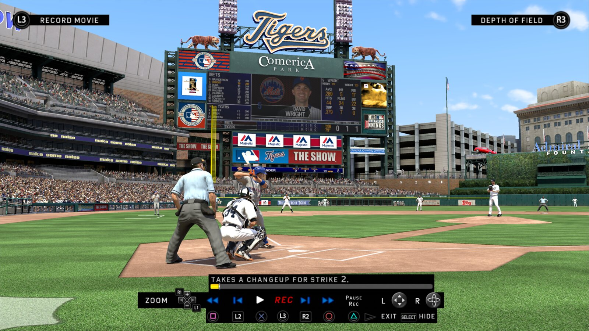
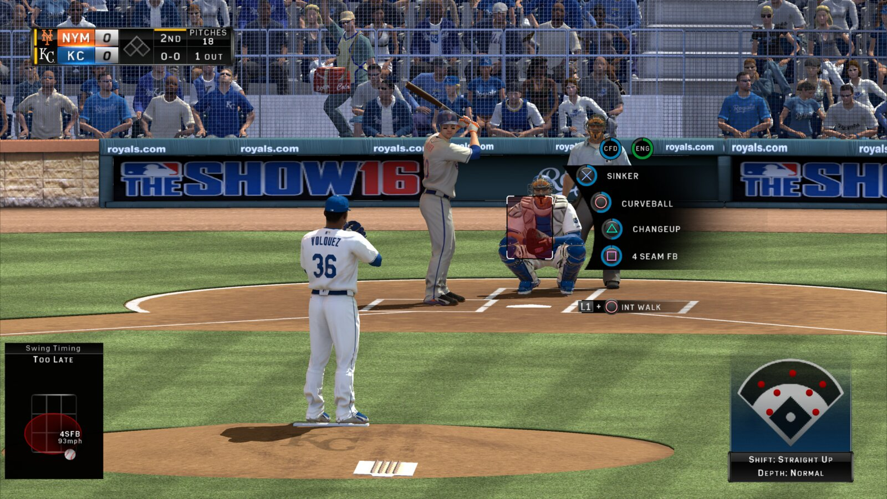
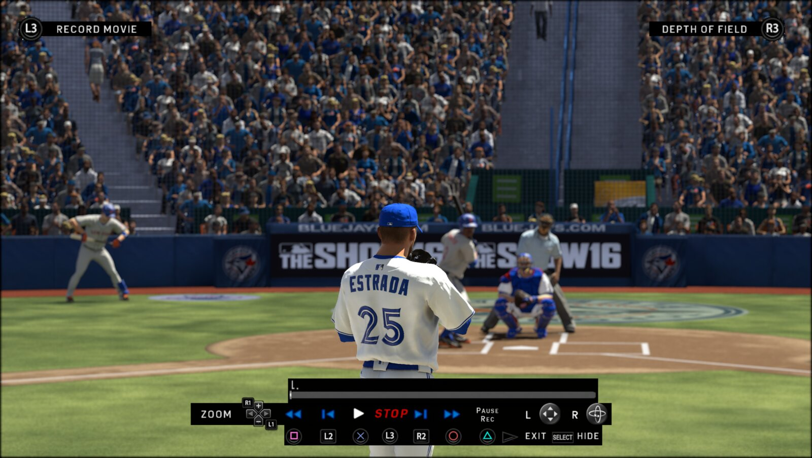
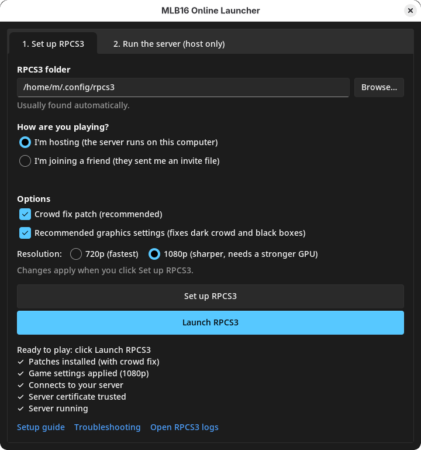
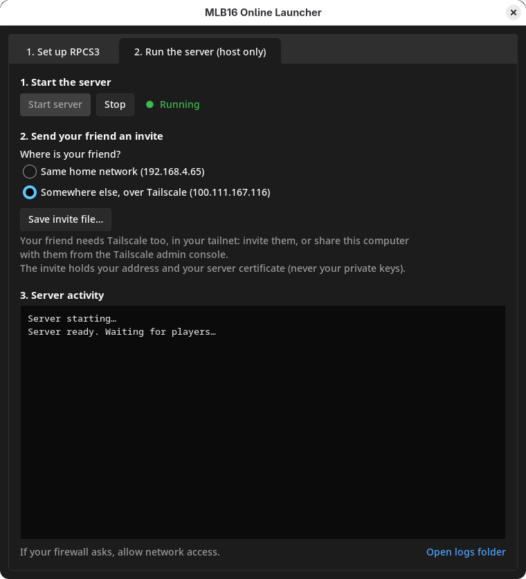

# MLB The Show 16 revival server (PS3 / RPCS3)

**Play *MLB The Show 16* online again: 1v1 against a friend, both on RPCS3.**

Sony shut down the game's online service in 2020 with update 1.10. This repo is a small private server plus five RPCS3
game patches that bring back **Game Rooms**: join a room, see each other, chat, send a challenge, and play a full game.

> **Status: it works!** First online 1v1 game played on October 25, 2026 (Linux PC vs M1 Mac, same home network),
> then Windows 11 vs M1 Mac the same day, through a full inning and a concede, and then over the internet (home
> Wi-Fi vs a phone hotspot, through Tailscale), set up entirely with the launcher.
> Since then, several full 9-inning games have been played, mostly without issues. Please report anything you find.

| | |
|---|---|
| ✅ | Online menus unlocked, PSN sign-in through RPCN, login to the game server |
| ✅ | Game Rooms: room list, player list, chat |
| ✅ | Challenging a player, accepting, and the pre-game handshake |
| ✅ | Peer-to-peer connection and **playing a 1v1 game** |
| ✅ | Playing over the internet: the server through Tailscale, the match through RPCN's direct connection (two separate home networks, and home Wi-Fi vs a phone hotspot) |
| ✅ | Windows: server and game on Windows 11, playing against a Mac |
| ✅ | Conceding: the other player accepts, and both games go back to the room |
| ✅ | **Online Home Run Derby**: both players join the same random lobby and play (tested Linux PC vs M1 Mac) |
| ✅ | **MLB16 Online Launcher**: set up RPCS3 and host or join with an invite file, tested on Fedora, Windows 11 and macOS |
| ✅ | Reliability: several full 9-inning games played, mostly issue-free (earlier testing had one drop before a game, one stuck on stadium select, and one RPCS3 graphics crash, the last traced to settings the launcher now resets) |
| ❓ | Saving results and stats after a game or Derby |
| ❌ | Other online modes (Diamond Dynasty, Online Rated, Franchise…): out of scope for now |

### How good it can look

RPCS3 at 1080p and 300% Sharpness, with the launcher's graphics settings and patches (crowd fix, better depth of field,
face fix):

| | |
|---|---|
|  |  |

## What you need

Every player does these once, in this order:
1. **RPCS3**: [rpcs3.net](https://rpcs3.net/download), on Windows, Linux or macOS.
2. **PS3 system firmware**: download `PS3UPDAT.PUP` from Sony's
   [PS3 system software page](https://www.playstation.com/en-us/support/hardware/ps3/system-software/), then install it
   with **File → Install Firmware**.
3. **Your own copy of the game, disc version (BCUS01089)**. Any of these works:
   - a **decrypted ISO** (recommended): add it with **File → Add ISO Games**;
   - a raw 1:1 disc image with your disc's key next to it (same name, ending in `.dkey`): also File → Add ISO Games;
   - a folder dump made on your own PS3 (for example with multiMAN or ManaGunZ): add it with File → Add Games.
4. **The v01.10 update**. Available from Sony's own update servers. Install it with **File → Install Packages/Raps/Edats**:
   [UP9000-BCUS01089_00-MLB16THESHOWBDPA-A0110-V0100-PE.pkg](http://b0.ww.np.dl.playstation.net/tppkg/np/BCUS01089/BCUS01089_T10/07a5f28c76691db4/UP9000-BCUS01089_00-MLB16THESHOWBDPA-A0110-V0100-PE.pkg)
   To check: RPCS3's game list should now show version **01.10** for MLB The Show 16.
5. **A free RPCN account** (RPCS3's stand-in for PSN): in RPCS3, **Configuration → RPCN → Create Account**, then
   confirm it with the token from the email. Each player needs their own account (two players can't share one), and
   has to be logged in to it.
6. **MLB16 Online Launcher** (this project's app): see [Setup](#setup).

One player also hosts the server, usually on the PC they play on. The launcher does that too.

Tested on:
- Ryzen 5 2600X, 32 GB DDR4, RTX 3060 Ti: Fedora 44 and Windows 11 (same PC, dual boot)
- MacBook Air M1, 16 GB, macOS 27
- RPCS3 v0.0.43-20397 (Windows, macOS) and v0.0.43-20394 (Fedora). Newer builds will very likely work too.

The patches are made for the disc version's v01.10 EBOOT. The digital version (NPUA81353) has a different EBOOT and
isn't supported yet.

## Setup

### Get the launcher

Download **MLB16 Online Launcher** from the [Releases page](https://github.com/MatRanc/mlb16-revival-server/releases/latest)
(Windows or macOS) and unzip it. It sets up RPCS3 in one click (the patches, the game's network and graphics
settings, and the server certificate), runs the server, and makes invite files. It only changes MLB The Show 16:
your other games keep their settings and their online features.

The launcher isn't signed, so the first launch needs one extra click:
- **Windows:** "Windows protected your PC" → **More info** → **Run anyway**.
- **macOS:** right-click the launcher → **Open** → **Open**. If macOS still refuses, go to System Settings → Privacy &
  Security and click **Open Anyway**.
- **Linux:** no download yet. Run it from source (see [TECHNICAL.md](TECHNICAL.md#building-and-development)).

<table>
  <tr>
    <td></td>
    <td></td>
  </tr>
  <tr>
    <td align="center"><em>Tab 1: Set up RPCS3 (everyone)</em></td>
    <td align="center"><em>Tab 2: Run the server (host only)</em></td>
  </tr>
</table>

### Host and join a game

**The host:**
1. Close RPCS3. **Set up RPCS3** tab → check the RPCS3 folder (on Windows, the folder with `rpcs3.exe`; click
   **Browse…** if it's empty) → "I'm hosting" → **Set up RPCS3**.
   Under **Output**, 720p runs fastest; 1080p is sharper if your graphics card can handle it. **Sharpness**
   renders bigger and shrinks it to fit, for smoother edges: it only costs GPU power (500% ran fine on an RTX 3060 Ti).
2. **Run the server** tab → **Start server**. Allow network access if your firewall asks. Keep the launcher open while you
   play: closing it stops the server.
3. **Save invite file…** and send it to your friend (Discord, email, anything: it holds your address and your
   public certificate, no secrets). Under "Where is your friend?", pick Tailscale if they're not on your home network
   (see below). If your address changes (a router restart, or switching between home network and Tailscale), save a
   new invite: your friend opens it and clicks **Set up RPCS3** again.

**Your friend:** download and unzip the launcher too. Close RPCS3, then **Set up RPCS3** tab → check the RPCS3
folder → "I'm joining a friend" → **Open invite…** → **Set up RPCS3**. Playing over the internet? Accept the host's
Tailscale share first ([step 2 below](#playing-over-the-internet-tailscale)).

**Then both of you:** **Launch RPCS3** → boot the game → **Online → Game Rooms** → pick the **Revival Room**. Select your friend,
choose **Challenge**, and they accept from the **Quick Menu** (SELECT). Your computer may ask whether RPCS3 can use
the network: allow it.

The first time you boot the game, RPCS3 prepares its code, which can take several minutes (there's a progress bar).
The first few games can also stutter briefly while graphics get prepared. Both only happen once.

### Playing over the internet: Tailscale

[Tailscale](https://tailscale.com) (free) connects the two computers so your friend can reach your server, with no
port forwarding. Tested on two separate home networks, and with the host on home Wi-Fi and the other player on a
phone hotspot.

1. **Both of you** install Tailscale ([tailscale.com/download](https://tailscale.com/download)) and sign in. Each of
   you uses your own account. (Two computers of your own can just use the same account and skip step 2.)
2. **The host shares their computer with the friend:** in the [admin console](https://login.tailscale.com/admin/machines),
   click **⋯** next to your computer → **Share…**, and send the invite link to your friend. They open it and accept.
   Your computer then shows up in their Tailscale. Sharing gives access to that one computer only, not your network,
   and you can stop sharing from the same menu.
3. **The host** opens the **Run the server** tab (Tailscale has to be running), picks **over Tailscale**,
   saves the invite file and sends it. Your friend opens it in the launcher and clicks **Set up RPCS3**.

**Does Tailscale slow down Discord or the game?** No. Tailscale only carries traffic sent to the other computer's
Tailscale address, which here is just the game server (logins, the room list, chat and challenges: very little data).
Discord, your browser and the match itself keep using your normal internet connection, so there's no split
tunneling to set up. (The one exception is a Tailscale "exit node", which is off unless you turn it on.)

The match connects directly between the two games (RPCN sets that up). If a challenge is accepted but the match
never starts, make sure UPnP is on in both routers (Set up already turns it on in RPCS3).

## Troubleshooting

| What you see | What to do |
|---|---|
| **"ONLINE DISABLED … no longer available"** | The patches aren't active, or your game isn't on update v01.10. Run **Set up RPCS3** again with RPCS3 closed. |
| **"The Online features of MLB The Show are disabled"** | PSN sign-in failed. Log in to RPCN in RPCS3 (Configuration → RPCN). |
| **"Your connection to The Show Online has been lost"** right away | The game can't reach the server. Is the host's server running? Over the internet: is Tailscale on for both of you, and did the friend accept the share? Did the friend run **Set up RPCS3** with the latest invite? |
| **A player is missing from the room** | Wait up to 8 s. Still missing: leave the room and join it again. |
| **Stuck on the stadium select screen** | Back out and send a new challenge. Seen once, cause unknown. |
| **Dark crowd, or a black box around the runner's lead-off view** | The graphics settings aren't on. Keep "Accurate graphics" ticked in the launcher and run **Set up RPCS3** again. |
| **The game runs slow** | Pick **720p** in the launcher and run **Set up RPCS3** again. Unticking "Accurate graphics" barely helps since v0.4.12, and it makes the crowd dark and coaches' faces white. Close-ups (walk-ups, mound visits) at 15 to 25 FPS are normal on mid-range CPUs: they're limited by the CPU, not by these settings. |
| **A coach or generic player has a white, plastic-looking face** | The game saved a broken copy of that face earlier (built while Write Color Buffers was off). Keep "Accurate graphics" ticked and run **Set up RPCS3**: when it turns that setting on, it also moves the saved faces aside (`HeadFaceCacheFile` in RPCS3's `dev_hdd0/game/BCUS01089_R/USRDIR/` folder; you can delete it by hand with RPCS3 closed). The game rebuilds the faces the next time it loads a game. |
| **Part of the crowd flickers or disappears when the camera moves** | Quit to the menu and start a new game (no need to restart RPCS3) to get a fresh crowd. The game builds a new crowd layout every time a game starts, and some layouts seem to trigger it. Seen once at Comerica Park. |
| **The match freezes for both players** | One player's RPCS3 stopped, and the other game is waiting for it. Close both games and start again. If it keeps happening, run **Set up RPCS3** again (it resets the settings that froze matches in testing), and keep your RPCS3 log: it says what went wrong. |

**Something else?** Before restarting anything, save the RPCS3 log (`RPCS3.log`: **Open RPCS3 logs** in the
launcher's setup tab opens its folder; it's in the RPCS3 folder on Windows, `~/Library/Caches/rpcs3` on macOS,
`~/.cache/rpcs3` on Linux) and the host's server log (`requests.jsonl` in the folder that **Open logs folder** opens,
in the **Run the server** tab), then open an issue. Neither log holds anyone's internet address or password (see
[Safety and security](#safety-and-security)).

## Safety and security

Fair question for any download from a stranger on the internet. What this project does and doesn't do:

- **It's all open source.** The launcher, the server and the patches are plain Python and YAML in this repo. The
  downloads on the Releases page are built by GitHub from this exact code (you can see each build's log under
  [Actions](https://github.com/MatRanc/mlb16-revival-server/actions)). Windows and macOS warn about them only because
  they aren't signed, which costs money.
- **Don't take my word for it.** Download the repo as a ZIP and give it to an AI assistant (Claude, ChatGPT,
  DeepSeek…) with a question like "Is this safe to run? What does it change on my computer?" It's small enough for
  that, or have a technical friend look.
- **It only changes RPCS3, and only for this game.** The launcher writes MLB The Show 16's patches and per-game settings,
  and adds the host's certificate to RPCS3's emulated PS3 certificates (the originals are kept). It doesn't touch
  your system, your browser or your other games' settings. Exactly what it changes is listed in
  [TECHNICAL.md](TECHNICAL.md#building-and-development).
- **The invite file has no secrets.** It holds the host's address and the host's public certificate. The host's
  private keys never leave their computer.
- **Only accept invites from people you trust.** The certificate in an invite becomes trusted by RPCS3's emulated
  PS3, so its owner could in theory impersonate other game servers to RPCS3 on your computer. Your real browser and
  system are not affected. Re-running **Set up RPCS3** with another invite replaces the old certificate.
- **The host shares as little as possible.** With Tailscale, the host shares one computer, not their network, and
  can stop sharing at any time. The server only speaks the game's protocol: logins, the room list, chat and
  challenges.
- **The logs are safe to share.** Neither log contains anyone's internet (public) IP address: the server only sees
  home-network and Tailscale addresses, and RPCS3 doesn't record the other player's address, even in a match over
  the internet (checked in logs from both). The server log holds RPCN usernames, but not the sign-in ticket or the
  console ID, which it leaves out. RPCS3's log shows folder paths, which can include your computer's user name.
- **Update check:** when it starts, the launcher asks GitHub for the latest release (one request, which GitHub sees
  like any download) and shows an "Update available" link if there's a newer one. It never downloads or installs
  anything by itself.

## Technical details

How it works, the patches, building the launcher, and notes for reviving other games: [TECHNICAL.md](TECHNICAL.md).
Contributions and test reports are welcome: open an issue.

**Fun fact:** getting from the "ONLINE DISABLED" popup to a full 1v1 game took about 8 hours and roughly $60 in Claude
API costs.

Related: [mlb-show-rpcs3-fixes](https://github.com/MatRanc/mlb-show-rpcs3-fixes) fixes the crowd rendering bug on
RPCS3, keeps a copy of the face fix and the RPCS3 settings notes, and documents the Ghidra/RenderDoc workflow used for
both projects.

## Credits

- [RPCS3](https://rpcs3.net) and its team: the emulator, its IP/Hosts switch and patch system make all of this
  possible.
- [RPCN](https://github.com/RipleyTom/rpcn): the PSN stand-in that handles sign-in and connects the two games for
  the match.
- [Tailscale](https://tailscale.com): reaching the host's server from another network.
- [Ghidra](https://ghidra-sre.org) with [Ps3GhidraScripts](https://github.com/clienthax/Ps3GhidraScripts) and
  [GhidraMCP](https://github.com/LaurieWired/GhidraMCP), and [RenderDoc](https://renderdoc.org) with
  [renderdoc-mcp](https://github.com/Linkingooo/renderdoc-mcp): finding the online lock, the patches and the graphics
  fixes.
- The launcher uses [Sun Valley ttk theme](https://github.com/rdbende/Sun-Valley-ttk-theme),
  [PyYAML](https://pyyaml.org), [cryptography](https://cryptography.io),
  [PyCryptodome](https://www.pycryptodome.org) and is packaged with [PyInstaller](https://pyinstaller.org).

## Legal
This repo contains no game code, game files or Sony data: no EBOOT, no WAD contents, no config files, no captures.
It describes how the game talks to its servers so people can keep playing a game they own. You need your own copy of
the game. MLB The Show is © Sony Interactive Entertainment. Not affiliated with Sony or MLB.

## License
[Apache License 2.0](LICENSE).
