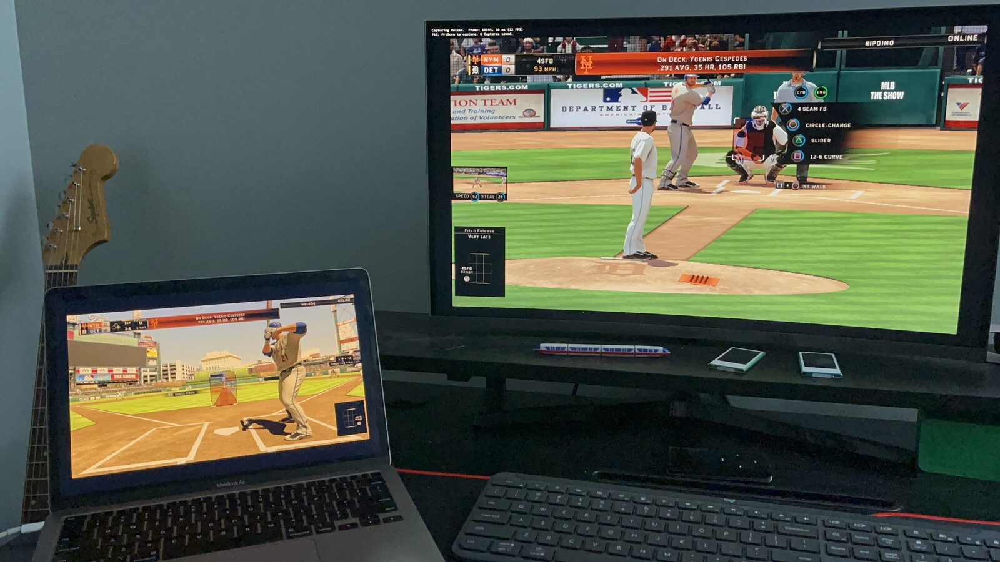
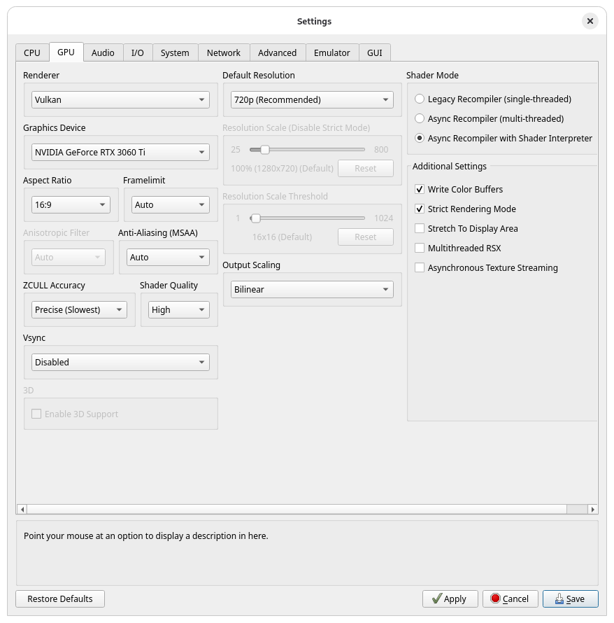
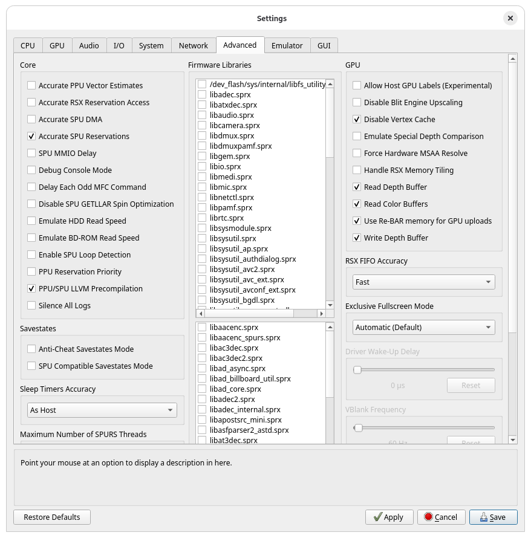
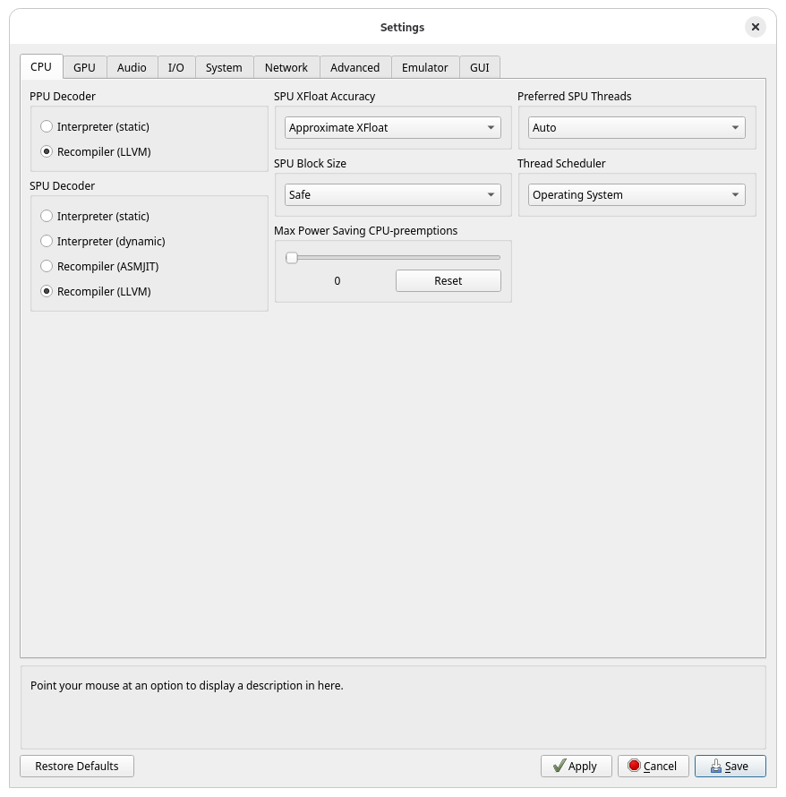

# MLB The Show 16 revival server (PS3 / RPCS3)

**Play *MLB The Show 16* online again: 1v1 against a friend, both on RPCS3.**

Sony shut down the game's online service in 2020 with update 1.10. This repo is a small private server plus five RPCS3
game patches that bring back **Game Rooms**: join a room, see each other, chat, send a challenge, and play a full game.



> **Status: it works!** First online 1v1 game played on October 25, 2026 (Linux PC vs M1 Mac, same home network),
> then Windows 11 vs M1 Mac the same day, through a full inning and a concede, and then over the internet (home
> Wi-Fi vs a phone hotspot, through Tailscale), set up entirely with the app.
> It's still early: expect rough edges, and please report what you find.

| | |
|---|---|
| ✅ | Online menus unlocked, PSN sign-in through RPCN, login to the game server |
| ✅ | Game Rooms: room list, player list, chat |
| ✅ | Challenging a player, accepting, and the pre-game handshake |
| ✅ | Peer-to-peer connection and **playing a 1v1 game** |
| ✅ | Playing over the internet: the server through Tailscale, the match through RPCN's direct connection (home Wi-Fi vs a phone hotspot) |
| ✅ | Windows: server and game on Windows 11, playing against a Mac |
| ✅ | Conceding: the other player accepts, and both games go back to the room |
| ✅ | **MLB16 Online app**: set up RPCS3 and host or join with an invite file, tested on Fedora, Windows 11 and macOS |
| ❓ | Reliability: one early attempt dropped before the game started, one got stuck on stadium select, and RPCS3 once crashed mid-game with a graphics error |
| ❓ | Saving results after a game |
| ❌ | Other online modes (Diamond Dynasty, Online Rated, Franchise…): out of scope for now |

## What you need

Every player needs:
- **RPCS3**: [rpcs3.net](https://rpcs3.net/download), on Windows, Linux or macOS.
- **PS3 system firmware**: download `PS3UPDAT.PUP` from Sony's
  [PS3 system software page](https://www.playstation.com/en-us/support/hardware/ps3/system-software/), then install it
  with **File → Install Firmware**.
- **Your own copy of the game, disc version (BCUS01089)**, as a decrypted dump. Dumping the disc on your own PS3 (for
  example with multiMAN or ManaGunZ) gives you one directly. A raw 1:1 disc image has to be decrypted first with your
  disc's key (for example with PS3Dec).
- **The v01.10 update**, from Sony's own update servers. Install it with **File → Install Packages/Raps/Edats**:
  [UP9000-BCUS01089_00-MLB16THESHOWBDPA-A0110-V0100-PE.pkg](http://b0.ww.np.dl.playstation.net/tppkg/np/BCUS01089/BCUS01089_T10/07a5f28c76691db4/UP9000-BCUS01089_00-MLB16THESHOWBDPA-A0110-V0100-PE.pkg)
- **A free RPCN account** (RPCS3's stand-in for PSN), created inside RPCS3.

One player also hosts the server, usually on the PC they play on. Running the app needs Python 3.10+ for now.

Tested on:
- Ryzen 5 2600X, 32 GB DDR4, RTX 3060 Ti: Fedora 44 and Windows 11 (same PC, dual boot)
- MacBook Air M1, 16 GB, latest macOS

The patches are made for the disc version's v01.10 EBOOT. The digital version (NPUA81353) has a different EBOOT and
isn't supported yet.

## Setup

The **MLB16 Online app** (`app/`) does the whole setup in one click: the patches, the per-game settings (network,
graphics) and the certificate. It also runs the server and makes invite files. It only touches MLB The Show 16:
other games keep their settings and their online features.

```sh
git clone https://github.com/MatRanc/mlb16-revival-server && cd mlb16-revival-server/app
python3 -m venv .venv
.venv/bin/pip install -r requirements.txt      # Windows: .venv\Scripts\pip install -r requirements.txt
.venv/bin/python mlb16_online.py               # Windows: .venv\Scripts\python mlb16_online.py
```
On Linux, tkinter may be a separate package (`sudo dnf install python3-tkinter`). On macOS with Homebrew's Python:
`brew install python-tk`.

**The host:**
1. **Set up RPCS3** tab → "Me, on this computer" → **Set up RPCS3** (with RPCS3 closed).
2. **Host a game** tab → **Start server**. Allow network access if your firewall asks.
3. **Save invite file…** and send it to your friend (Discord, email, anything: it holds your address and your
   public certificate, no secrets). Pick the Tailscale address if they're not on your home network (see below).

**Your friend:** **Set up RPCS3** tab → "A friend, who sent me an invite file" → **Open invite…** → **Set up RPCS3**.

**Then both of you:** boot the game → **Online → Game Rooms** → pick the room. Select your friend, choose
**Challenge**, and they accept from the **Quick Menu** (SELECT).

### Playing over the internet: Tailscale

[Tailscale](https://tailscale.com) (free) connects the two computers so your friend can reach your server, with no
port forwarding. Tested: host on home Wi-Fi, other player on a phone hotspot.

1. **Both of you** install Tailscale ([tailscale.com/download](https://tailscale.com/download)) and sign in. Each of
   you uses your own account. (Two computers of your own can just use the same account and skip step 2.)
2. **The host shares their computer with the friend:** in the [admin console](https://login.tailscale.com/admin/machines),
   click **⋯** next to your computer → **Share…**, and send the invite link to your friend. They open it and accept.
   Your computer then shows up in their Tailscale. Sharing gives access to that one computer only, not your network,
   and you can stop sharing from the same menu.
3. **The host** opens the **Host a game** tab (Tailscale has to be running), picks the **Tailscale** address,
   saves the invite file and sends it. Your friend opens it in the app and clicks **Set up RPCS3**.

Only the game server goes through Tailscale. Everything else on both computers, like Discord, the browser and the
match itself, uses the normal internet connection, so there's nothing to split or tune. The match connects directly
between the two games (RPCN sets that up); turn on UPnP in your router if it won't connect.

The manual steps, without the app, are in [docs/setup-host.md](docs/setup-host.md) and
[docs/setup-player.md](docs/setup-player.md).

## Graphics settings

Right-click the game in RPCS3 → **Create Custom Configuration**, then set:
- **GPU:** Write Color Buffers, Strict Rendering Mode, ZCULL Accuracy *Precise*, Shader Quality *High*
- **Advanced:** Read Color Buffers, Read Depth Buffer, Write Depth Buffer, Disable Vertex Cache
- **CPU:** leave SPU XFloat Accuracy on *Approximate XFloat* and SPU Block Size on *Safe* (the defaults)

Without them, parts of the crowd go dark and the picture-in-picture windows (like the runner's lead-off) have a black
background. The crowd itself still needs the **crowd fix patch** from
[mlb-show-rpcs3-fixes](https://github.com/MatRanc/mlb-show-rpcs3-fixes), which also explains the rendering bug.

<table>
  <tr>
    <th>GPU</th>
    <th>Advanced</th>
    <th>CPU</th>
  </tr>
  <tr>
    <td></td>
    <td></td>
    <td></td>
  </tr>
</table>

## The patches

All five are in [`patches/MLB16_online.yml`](patches/MLB16_online.yml). **Both players need all five.**

| Patch | Why |
|---|---|
| Re-enable online menus | Update 1.10 replaced the online menu entry with an "ONLINE DISABLED" popup. |
| Skip live roster download | Sony's roster files are gone. Everyone keeps the built-in roster, so rosters always match. |
| Allow game room challenges | The "challenges allowed" flag is normally set by a step tied to Sony's servers, so the Challenge option never appeared. |
| Fix NP ID lookup hang | RPCS3 never finishes the game's opponent lookup (`sceNpLookupNpIdAsync`), so both players hung on "Challenge accepted, waiting for a response". |
| Faster game room player list | The room only re-downloads its player list every 30 s, and nothing tells it when someone joins. This makes it 8 s. |

The last one works around an RPCS3 bug. A fix in RPCS3 itself is on the
[`fix-np-lookup-npid-async`](https://github.com/MatRanc/rpcs3/tree/fix-np-lookup-npid-async) branch of my fork. Until
something like it is in an official build, keep the patch on.

## How it works

```
  RPCS3 (you)                                         RPCS3 (friend)
 ┌──────────────┐  game API (XML over HTTPS)  ┌─────────────┐  ┌──────────────┐
 │ MLB The Show │────────────────────────────►│ server.py   │◄─│ MLB The Show │
 │ 16 + patches │  FLS: rooms, chat,          │ (this repo) │  │ 16 + patches │
 │              │────────────────────────────►│             │◄─│              │
 └──┬────────┬──┘  challenges                 └─────────────┘  └──┬────────┬──┘
    │        │                                                    │        │
    │        │   sign-in, NP Signaling      ┌──────┐              │        │
    │        └─────────────────────────────►│ RPCN │◄─────────────┘        │
    │                                       └──────┘                       │
    └──────────────────── the match itself, peer to peer ──────────────────┘
```

- **The game's online code is all still there.** Update 1.10 only blocked the way in, and the patches undo that.
- **RPCS3's IP/Hosts switch** sends the game's dead Sony hostnames to this server. Adding your own certificate to
  the PS3 firmware's root certificates makes the game trust it.
- **The server** answers the game's XML web API and runs **FLS**, its live session server (AES-encrypted XML over TCP),
  which relays room chat and challenges between players.
- **RPCN** handles sign-in and NP Signaling, which connects the two games directly for the match.

The full protocol write-up is in [docs/protocol.md](docs/protocol.md).

## Known limits
- The player list is refreshed on a timer (8 s with the patch, 30 s without), so a player who just joined can take
  that long to appear. As far as we can tell, the game only downloads the list when you join and on that timer.
- Some player-list columns may show blank or zero: the column names are guesses, since the UI scripts are compiled.
- Endpoints the server doesn't know get an empty "OK" reply. That's enough for everything Game Rooms needs so far.

## Repo

| | |
|---|---|
| `app/` | the MLB16 Online app: RPCS3 setup, server start/stop, invite files (`test_setup_logic.py` tests it) |
| `server/server.py` | the server: game API, FLS, logging |
| `server/make_certs.sh` | makes your own root CA and server certificate |
| `server/certswap.sh`, `certswap.ps1` | adds the host's CA to RPCS3's certificates, keeping the originals (Linux/macOS, Windows) |
| `patches/MLB16_online.yml` | the five RPCS3 patches |
| `patches/MLB16_crowd_fix.yml` | the crowd fix from [mlb-show-rpcs3-fixes](https://github.com/MatRanc/mlb-show-rpcs3-fixes), installed by the app |
| `docs/setup-host.md`, `setup-player.md` | setup guides |
| `docs/protocol.md` | hosts, TLS, the XML API, login, rooms, FLS, challenges, the pre-game handshake |
| `docs/endpoints.md` | all 347 API services the game knows, and which ones the server answers |
| `docs/code-map.md` | where things are in the game's code (addresses and our names) |
| `docs/research.md` | how to get the game's own config files from your copy and dig further |
| `tools/extract_gamedata.py` | extracts `servers_prod.xml` / `services.xml` from your installed update |

Contributions and test reports are welcome. [AGENTS.md](AGENTS.md) has the ground rules: most importantly, never commit
game files, Sony data, logs or certificate keys.

**Fun fact:** getting from the "ONLINE DISABLED" popup to a full 1v1 game took about 8 hours and roughly $60 in Claude
API costs.

Related: [mlb-show-rpcs3-fixes](https://github.com/MatRanc/mlb-show-rpcs3-fixes) fixes the crowd rendering bug on
RPCS3, and documents the Ghidra/RenderDoc workflow used for both projects.

## Legal
This repo contains no game code, game files or Sony data: no EBOOT, no WAD contents, no config files, no captures.
It describes how the game talks to its servers so people can keep playing a game they own. You need your own copy of
the game. MLB The Show is © Sony Interactive Entertainment. Not affiliated with Sony or MLB.

## License
[Apache License 2.0](LICENSE).
